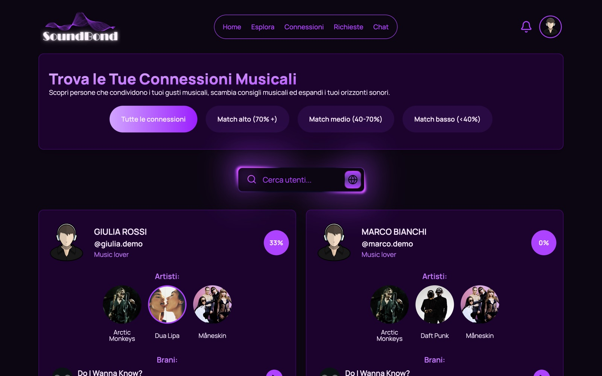

# SoundBond – Backend

SoundBond è un social network musicale che mette in contatto persone con gusti simili: calcola la compatibilità tra utenti in base a generi e artisti preferiti e permette di connettersi e chattare in tempo reale.
Questo repository contiene l'API (ASP.NET Core). Il client web si trova in [SoundBond-Frontend](https://github.com/camillazicari/SoundBond-Frontend).



Progetto finale del corso di sviluppo web full-stack (aprile–luglio 2025), sviluppato da [Camilla Zicari](https://github.com/camillazicari).

## Funzionalità principali

- Registrazione, login e gestione dell'account con ASP.NET Identity; autenticazione stateless con token JWT.
- Profilo utente con caricamento dell'immagine (salvata in `wwwroot/images`) e bio.
- Gusti musicali per utente: generi, artisti e brani (CRUD).
- Elenco degli utenti con i rispettivi gusti, usato dal client per calcolare la compatibilità.
- Richieste di connessione (inviate, ricevute, annullate) e legami tra utenti ("bonders").
- Chat privata in tempo reale con SignalR: invio dei messaggi, persistenza, conferme di lettura, elenco delle conversazioni ed eliminazione di una chat per un solo utente.
- Recensioni sulla piattaforma.

## Scelte tecniche

- **ASP.NET Core 8 Web API** con controller e servizi registrati tramite dependency injection; documentazione Swagger con supporto al token Bearer.
- **Entity Framework Core + SQL Server**, approccio code-first con migrazioni (`SoundBond/Migrations`).
- **ASP.NET Identity** con utenti e ruoli personalizzati (`ApplicationUser`, `ApplicationRole`); le regole sulle password sono configurabili da `appsettings.json`.
- **JWT**: emissione del token al login e validazione di issuer, audience, scadenza e firma. Per l'hub SignalR il token viene letto dalla query string (`access_token`), perché i WebSocket del browser non permettono header personalizzati.
- **SignalR** (`Hubs/ChatHub.cs`): ogni coppia di utenti condivide un gruppo; un `IUserIdProvider` personalizzato associa le connessioni all'id utente, così le notifiche raggiungono anche chi non ha la chat aperta.
- **Configurazione senza segreti nel repository**: stringa di connessione e chiave JWT vengono da `dotnet user-secrets` in sviluppo e da variabili d'ambiente in produzione. L'app si ferma all'avvio con un messaggio chiaro se mancano.

## Architettura

```
SoundBond-Frontend (React)
   │  REST + JWT, WebSocket SignalR
   ▼
SoundBond (ASP.NET Core 8, porta 5220)
   ├── Controllers/   endpoint REST /api/*
   ├── Hubs/          ChatHub su /chatHub
   ├── Services/      logica applicativa
   ├── Data/          SoundBondDbContext (EF Core + Identity)
   ├── Models/, DTOs/
   └── Migrations/
   │
   ▼
SQL Server
```

Endpoint principali (elenco completo su Swagger):

| Area | Rotte |
| --- | --- |
| Account | `POST /api/Account/register`, `POST /api/Account/login`, `GET /api/Account/userLogged`, `GET /api/Account/utenti` |
| Gusti | `/api/Generi`, `/api/Artisti`, `/api/Brani` |
| Profilo | `GET/POST/PUT /api/Profilo` |
| Connessioni | `/api/Richiesta`, `/api/Bonders` |
| Chat | `GET /api/Messages/conversazioni`, `GET /api/Messages/{userId}`, hub `/chatHub` |
| Recensioni | `/api/Recensioni` |

## Avvio in locale

Prerequisiti: [.NET 8 SDK](https://dotnet.microsoft.com/download/dotnet/8.0) e un'istanza di SQL Server. Su macOS o Linux la si può avviare con Docker:

```bash
docker run -d --name soundbond-sql -e ACCEPT_EULA=Y -e MSSQL_SA_PASSWORD='<password-sicura>' -p 1433:1433 mcr.microsoft.com/mssql/server:2022-latest
```

Su Mac con Apple Silicon aggiungi `--platform linux/amd64` e usa un runtime con emulazione Rosetta (per esempio Colima avviato con `--vm-type vz --vz-rosetta`).

Configura i segreti, crea il database e avvia l'API:

```bash
git clone https://github.com/camillazicari/SoundBond-Backend.git
cd SoundBond-Backend
dotnet tool restore
dotnet user-secrets set "ConnectionStrings:DefaultConnection" "Server=localhost,1433;Database=SoundBond;User Id=sa;Password=<password-sicura>;TrustServerCertificate=true" --project SoundBond
dotnet user-secrets set "Jwt:SecurityKey" "$(openssl rand -hex 32)" --project SoundBond
dotnet ef database update --project SoundBond
dotnet run --project SoundBond
```

L'API risponde su `http://localhost:5220` e Swagger è su `http://localhost:5220/swagger`. Per il client web segui le istruzioni di [SoundBond-Frontend](https://github.com/camillazicari/SoundBond-Frontend).

### Utenti dimostrativi

Con l'API avviata, lo script seguente crea quattro utenti con gusti in parte sovrapposti, ciascuno con profilo, generi, artisti (con immagini da Deezer) e un brano per artista. Serve per provare matching e chat:

```bash
DEMO_PASSWORD='<almeno-8-caratteri>' ./scripts/seed-demo.sh
```

Gli account sono `giulia.demo`, `marco.demo`, `sara.demo` e `luca.demo`, tutti con dominio `@demo.soundbond.test` e la password scelta.

### Configurazione

| Chiave | Dove impostarla | Note |
| --- | --- | --- |
| `ConnectionStrings:DefaultConnection` | user-secrets / variabile `ConnectionStrings__DefaultConnection` | obbligatoria |
| `Jwt:SecurityKey` | user-secrets / variabile `Jwt__SecurityKey` | obbligatoria, almeno 32 byte |
| `Cors:AllowedOrigins` | `appsettings.json` / variabili `Cors__AllowedOrigins__0`, `__1`, ... | default `http://localhost:5173` |
| `Jwt:Issuer`, `Jwt:Audience`, `Jwt:ExpiresInMinutes` | `appsettings.json` | |
| `Identity:*` | `appsettings.json` | regole sulle password |
